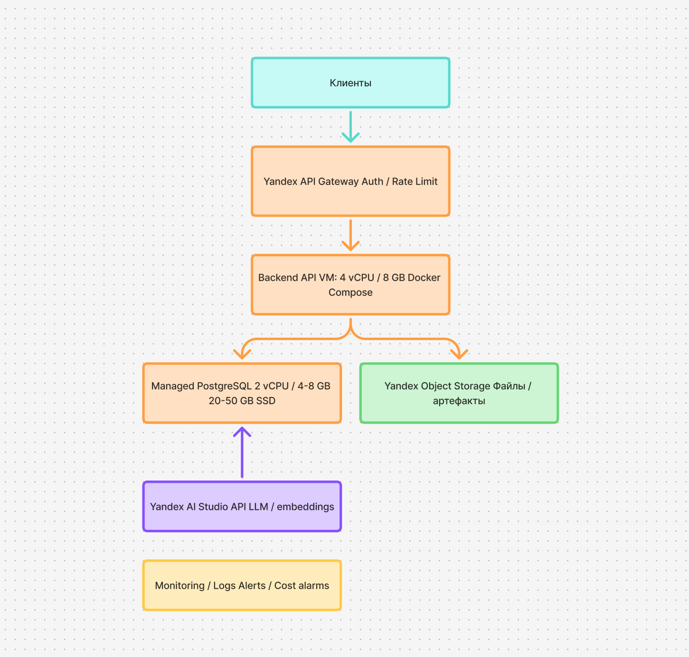
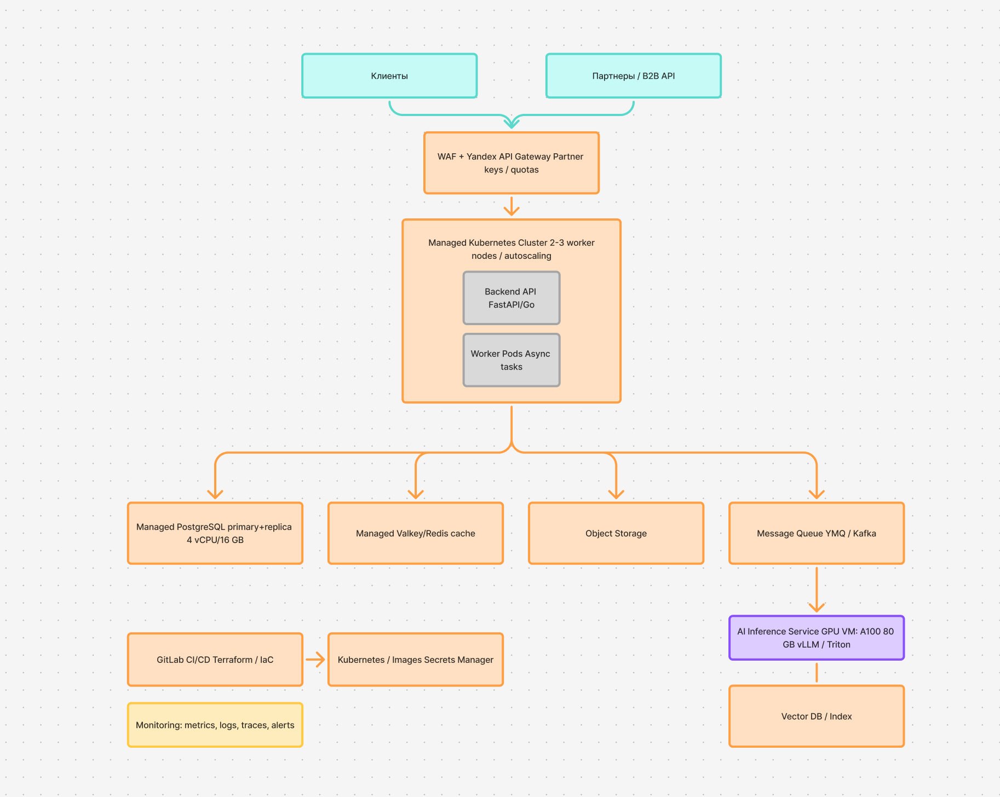
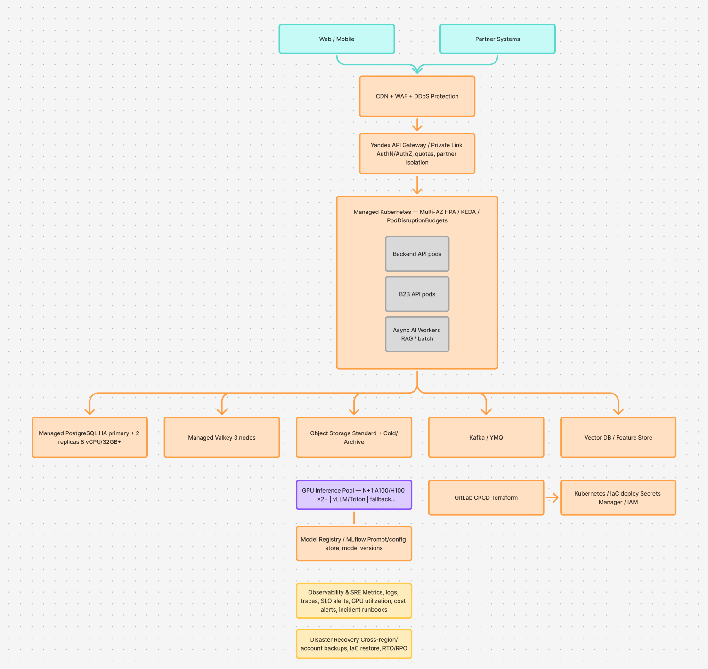

# Отчет по четвертой лабораторной
## Ход работы

## МВП

| Статья затрат | Компонент архитектуры | Драйвер затрат | Базовый сценарий, ₽/мес | Обоснование решения |
|---|---|---|---:|---|
| Edge-уровень | API Gateway, WAF | Количество запросов, правила безопасности | 5 000 | Централизованная точка входа, аутентификация и rate limiting |
| Application layer | Stateless backend, 2 vCPU / 4 GB | Вычислительные ресурсы, время работы | 15 000 | Контейнеризованный сервис с горизонтальным масштабированием в будущем |
| Persistence layer | Managed PostgreSQL, 2 vCPU / 8 GB, 50 GB SSD | vCPU, RAM, объём хранилища | 18 000 | Управляемая БД снижает операционную нагрузку и обеспечивает backup |
| Object storage | Standard storage, 200 GB | Объём данных и операции | 3 000 | Хранение файлов, артефактов и результатов обработки |
| AI layer | External LLM API | Количество токенов и запросов | 20 000 | Отсутствие CAPEX на GPU на этапе проверки product-market fit |
| Observability | Metrics, logs, alerts | Объём телеметрии | 6 000 | Контроль error rate, latency и cost anomalies |
| Support | 0,2 FTE DevOps | Трудозатраты | 40 000 | Частичная загрузка инженера на сопровождение |

## Пилот с партнерами 

| Статья затрат | Компонент архитектуры | Драйвер затрат | Базовый сценарий, ₽/мес | Обоснование решения |
|---|---|---|---:|---|
| Edge-уровень | WAF, API Gateway, partner API | Число интеграций, трафик, quota management | 20 000 | Изоляция партнёрских потоков, ключи доступа и лимиты |
| Container orchestration | Managed Kubernetes, 3 nodes | Количество узлов, автоскейлинг | 130 000 | Rolling updates, self-healing и масштабирование подов |
| Persistence layer | Managed PostgreSQL HA, 4 vCPU / 16 GB | vCPU, RAM, storage, replication | 85 000 | Read replica снижает нагрузку на primary и повышает availability |
| Caching layer | Managed Valkey / Redis | Объём памяти, число узлов | 35 000 | Снижение latency и разгрузка БД |
| Async processing | Message queue, worker pods | Количество сообщений и worker-часов | 30 000 | Декуплинг тяжёлых задач от синхронного пользовательского запроса |
| Object storage | Standard + Cold storage, 1 TB | Объём данных, класс хранения | 25 000 | Lifecycle policies снижают стоимость редко используемых данных |
| AI inference | External LLM API + batch GPU | Токены, GPU-часы | 320 000 | Гибридная модель: online-запросы через API, batch — на GPU |
| CI/CD и security | GitLab CI/CD, Terraform, Secrets Manager | Число pipelines, секреты | 35 000 | Infrastructure as Code и безопасное управление конфигурацией |
| Observability | APM, logs, traces, SLO alerts | Объём телеметрии | 40 000 | Контроль SLA, инцидентов и стоимости |
| Support | 0,7 FTE DevOps / ML | Трудозатраты | 180 000 | Эксплуатация, интеграции и развитие AI-функций |

## Прод

| Статья затрат | Компонент архитектуры | Драйвер затрат | Базовый сценарий, ₽/мес | Обоснование решения |
|---|---|---|---:|---|
| Edge-уровень | CDN, WAF, DDoS protection, API Gateway | Трафик, число правил, запросы | 80 000 | Защита от атак и перегрузок до попадания в core services |
| Container orchestration | Multi-AZ Managed Kubernetes, 6 nodes | Число узлов, зоны доступности, HPA | 300 000 | High availability, fault isolation и autoscaling |
| Persistence layer | Managed PostgreSQL HA, 8 vCPU / 32 GB, PITR | Реплики, storage, backup retention | 220 000 | Failover, point-in-time recovery и масштабирование чтения |
| Caching and messaging | Managed Valkey, Kafka / YMQ | Память, партиции, throughput | 160 000 | Разделение hot path и асинхронной обработки |
| Data platform | Object Storage lifecycle, vector DB, feature store | Объём данных, индексация, запросы | 160 000 | Разделение hot/cold data и поддержка RAG-сценариев |
| AI inference | GPU inference pool N+1, model registry | Количество GPU, utilization, версии моделей | 700 000 | SLA-совместимый inference, rollback и версионирование моделей |
| External AI fallback | LLM API для пиковых нагрузок | Токены, доля fallback-трафика | 80 000 | Защита от дефицита GPU и пиковых нагрузок |
| Observability and SRE | Metrics, logs, traces, incident management | Объём телеметрии, число алертов | 90 000 | SLO monitoring, root cause analysis и cost governance |
| Support | 1,5 FTE DevOps / SRE / ML | Трудозатраты | 400 000 | Круглосуточная эксплуатация, инциденты и оптимизация |

